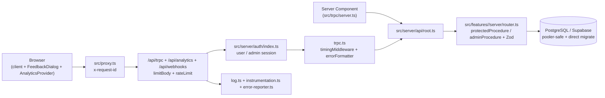

# Architecture

This is a Next.js App Router application with a typed tRPC API over PostgreSQL. Code is grouped by feature: each feature owns its components, router, and Zod schemas, while shared infrastructure sits in `src/server/` and `src/shared/`.

## Request flow

## Code map

Reuse these modules before writing new helpers.

| Path                                                | Responsibility                                  | Reuse, don't recreate                                                                                      |
| --------------------------------------------------- | ----------------------------------------------- | ---------------------------------------------------------------------------------------------------------- |
| `src/app/`                                          | Routes, layouts, API handlers, error boundaries | Fetch through `~/trpc/server` or `~/trpc/react`; route handlers may import `~/server/db`                   |
| `src/app/api/trpc/[trpc]/route.ts`                  | HTTP entry for tRPC                             | Applies `limitBody`, attaches `x-request-id`, logs errors in all envs                                      |
| `src/app/api/webhooks/payments/[provider]/route.ts` | Provider-agnostic payment webhook route         | Delegates to `handlePaymentWebhook`; `/api/webhooks/stripe` shares the same engine                         |
| `src/proxy.ts`                                      | Sets `x-request-id` on requests and responses   | Read it back via `requestIdFrom`                                                                           |
| `src/instrumentation.ts`                            | Next.js `register` and `onRequestError` hooks   | Logs crashes as JSON and forwards to Sentry when `SENTRY_DSN` is set                                       |
| `src/features/<name>/components/`                   | UI for one feature                              | Compose primitives from `~/shared/components/ui`                                                           |
| `src/features/<name>/server/router.ts`              | Feature tRPC router                             | Use `protectedProcedure` (filter by `ctx.ownerId`) or `adminProcedure`                                     |
| `src/features/<name>/schemas/`                      | Zod input schemas                               | Share one schema between router and client forms                                                           |
| `src/features/<name>/index.ts`                      | Public client-safe exports                      | Other code imports `~/features/<name>`, never deep paths                                                   |
| `src/server/auth/index.ts`                          | Isolated session & role resolver                | Swap `getServerSession` here for Better Auth or Supabase Auth                                              |
| `src/server/api/trpc.ts`                            | Context, timing middleware, procedures          | `publicProcedure`, `protectedProcedure`, `adminProcedure`, `rateLimit`                                     |
| `src/server/api/root.ts`                            | Aggregates feature routers                      | One entry per feature slice                                                                                |
| `src/server/api/rate-limit.ts`                      | Bounded sliding-window rate limiter             | `createMemoryRateLimiter`, `clientIpFrom`, `rateLimitResponse`                                             |
| `src/server/api/body-limit.ts`                      | 1 MB request body cap                           | `limitBody`                                                                                                |
| `src/server/api/parse.ts`                           | Validated route-handler body parsing            | `parseJsonBody` (handles invalid JSON -> 400), `readRawBody` for HMAC webhooks                             |
| `src/server/db/`                                    | Drizzle client, pooler options, and schema      | `options.ts` sets `prepare: false` for port `6543`/PgBouncer; `drizzle.config.ts` uses direct              |
| `src/server/db/owned.ts`                            | Patch builder for owned content tables          | `contentValues` in update mutations                                                                        |
| `src/server/payments/`                              | `PaymentProvider` interface & webhook engine    | Implement `PaymentProvider` under `src/server/payments/providers/`; active provider via `PAYMENT_PROVIDER` |
| `src/server/email.ts`                               | Transactional email via Resend HTTP API         | `sendEmail`; dev console fallback is local-dev only                                                        |
| `src/server/analytics.ts`                           | Server-side analytics & feature flags           | `trackServer` and `getFeatureFlag` (dormant when `POSTHOG_API_KEY` unset)                                  |
| `src/server/error-reporter.ts`                      | Zero-dep Sentry envelope error reporter         | Dormant unless `SENTRY_DSN` is set                                                                         |
| `src/server/cron.ts`                                | Constant-time bearer cron guard                 | `cronAuthorized` with `CRON_SECRET`                                                                        |
| `src/server/log.ts`                                 | JSON request and error logging                  | `logRequest`, `logError`, `requestIdFrom`                                                                  |
| `src/shared/components/ui/`                         | shadcn/Base UI primitives                       | Add with `bunx shadcn add`; keep feature logic out                                                         |
| `src/shared/components/analytics-provider.tsx`      | Opt-in client PostHog replay/heatmaps/flags     | Dormant unless `NEXT_PUBLIC_POSTHOG_KEY` is set; exposes `useFeatureFlag`                                  |
| `src/shared/config/env.js`                          | Validated environment schema                    | Import `{ env }` from here; never read `process.env` elsewhere                                             |
| `src/shared/config/site.ts`                         | Brand, titles, nav, legal copy                  | Read by layout, icon, OG image, sitemap, legal pages; gated by `make brand-check`                          |
| `src/shared/config/dev-guard.ts`                    | Local-dev shortcut guard                        | `devShortcutsEnabled`, `assertLocalDev`                                                                    |
| `src/shared/config/security-headers.js`             | Global HTTP security headers                    | Applied by `next.config.js`                                                                                |
| `src/shared/lib/utils.ts`                           | `cn` Tailwind class merger                      | Use for conditional classes                                                                                |
| `src/trpc/`                                         | tRPC React client, RSC caller, query client     | `api` from `~/trpc/react` or `~/trpc/server`                                                               |
| `packages/shared/tokens.ts`                         | Light & dark `oklch()` brand tokens             | Edit here, then run `make tokens` and `make contrast`                                                      |
| `packages/shared/analytics.ts`                      | Split client vs server analytics taxonomy       | `track` (client-safe only) vs `trackServer` (server events)                                                |
| `src/features/_example/`                            | Reference slice for `make new-feature`          | Remove with `make clean-examples` after creating real slices                                               |
| `e2e/`                                              | Playwright smoke, crawler, axe a11y specs       | Run with `make e2e`, `make crawl`, `make a11y`                                                             |
| `.storybook/`                                       | Mock providers and theme switcher               | Stories colocate as `*.stories.tsx`                                                                        |
| `drizzle/`                                          | Generated SQL migrations & snapshots            | Generate via `make db-generate`; gated by `make db-check`                                                  |
| `.ast-grep/rules/`                                  | Import boundary and anti-slop rules             | Every rule has matching tests in `.ast-grep/tests/`                                                        |

## Invariants

- Read environment variables only via `~/shared/config/env`. [enforced by ast-grep]
- `src/shared/**` never imports `~/features/**`. [enforced by ast-grep]
- Features import other features only via `~/features/<name>`. [enforced by ast-grep]
- `"use client"` files never import `~/server/**` or `server-only`. [enforced by ast-grep]
- Pages and layouts never import `~/server/db`. [enforced by ast-grep]
- Raw hex colors and raw form controls are banned outside UI primitives and generated tokens. [enforced by ast-grep]
- Route bodies go through `parseJsonBody` or `readRawBody`. [enforced by ast-grep]
- Money columns use `d.integer()` minor units; analytics uses taxonomy helpers; console logging lives only in `src/server/log.ts` and `src/server/email.ts`. [enforced by ast-grep]
- User-owned queries filter by `ctx.ownerId`; admin views require `adminProcedure`. [enforced by DB tests & review]
- Unauthenticated requests fail closed with `UNAUTHORIZED`; `TRUST_IDENTITY_HEADER` throws at boot in production/preview. [enforced by vitest]
- `drizzle/` migrations match `src/server/db/schema.ts` with zero drift. [enforced by `make db-check`]
- Every directory and dependency is declared in `scripts/repo-policy.json` and `docs/dependencies.md`. [enforced by `make policy`]

## Cross-cutting concerns

- **Config.** `src/shared/config/env.js` validates env vars with Zod at boot and skips validation only when `SKIP_ENV_VALIDATION=1`.
- **Errors.** tRPC `errorFormatter` attaches `requestId` (`x-request-id`) and redacts `INTERNAL_SERVER_ERROR` messages in production. Unhandled server/route errors pass through `src/instrumentation.ts` (`onRequestError`) and optional `reportServerError`.
- **Auth.** `src/server/auth/index.ts` provides `getServerSession`. Replace the `TRUST_IDENTITY_HEADER` stub before shipping (see `docs/recipes/auth-providers.md`).
- **Database.** `src/server/db/index.ts` auto-disables prepared statements on transaction poolers (`:6543`, `?pgbouncer=true`, `.pooler.supabase.com`) and bounds connection counts; `drizzle.config.ts` prefers `DATABASE_DIRECT_URL` for migrations.
- **Payments.** `src/server/payments/webhook.ts` verifies signatures via the active `PaymentProvider` adapter, deduplicates `(provider, eventId)` in Postgres `webhook_events`, and runs post-commit analytics outside the transaction.
- **Analytics.** `packages/shared/analytics.ts` separates client-safe events from server-only events (`subscription_started`, `signup_completed`) so browsers cannot forge billing or auth telemetry.
