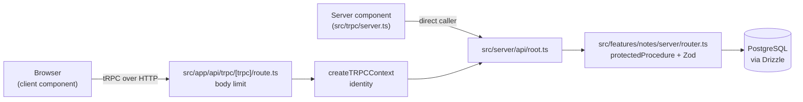

# Architecture

This is a Next.js App Router application with a typed tRPC API over PostgreSQL. Code is grouped by feature: each feature owns its components, router and schemas, and shared infrastructure sits beside the features. The browser calls tRPC procedures; procedures validate input with Zod and query the database through Drizzle with an owner predicate on every row.

## Request flow

## Code map

Reuse these before you write new code.

| Path                                    | Responsibility                                        | Reuse, don't recreate                                                                             |
| --------------------------------------- | ----------------------------------------------------- | ------------------------------------------------------------------------------------------------- |
| `src/app/`                              | Routes, layouts, error boundary. Thin: no data access | Fetch through `~/trpc/server` or `~/trpc/react`; route handlers may import `~/server/db`          |
| `src/app/api/trpc/[trpc]/route.ts`      | HTTP entry for tRPC                                   | Body size limit lives here via `limitBody`                                                        |
| `src/proxy.ts`                          | Request id for every log line and error response      | Read it back with `requestIdFrom`                                                                 |
| `src/features/<name>/components/`       | UI for one feature                                    | Compose primitives from `~/shared/components/ui`                                                  |
| `src/features/<name>/server/router.ts`  | The feature's tRPC router                             | Use `protectedProcedure`; filter by `ctx.ownerId`                                                 |
| `src/features/<name>/schemas/`          | Zod input schemas                                     | Share one schema between router and form                                                          |
| `src/features/<name>/index.ts`          | Public exports, client-safe only                      | Other code imports `~/features/<name>`, never a deep path                                         |
| `src/server/api/trpc.ts`                | tRPC context, identity, procedures                    | `protectedProcedure` for authenticated work; `resolveOwnerId` is the auth swap point              |
| `src/server/api/root.ts`                | Aggregates feature routers                            | Add one line per feature                                                                          |
| `src/server/api/body-limit.ts`          | Request body size limit                               | `limitBody`                                                                                       |
| `src/server/api/parse.ts`               | Validated route-handler bodies                        | `parseJsonBody` for JSON, `readRawBody` for HMAC webhooks                                         |
| `src/server/db/`                        | Drizzle client and schema                             | Define tables in `schema.ts`; import `db` only from `src/server` and each feature's server folder |
| `src/server/db/owned.ts`                | Patch builder for owned content tables                | `contentValues` in update mutations                                                               |
| `src/server/email.ts`                   | Transactional email over the Resend HTTP API          | `sendEmail`; console fallback in local development only                                           |
| `src/server/analytics.ts`               | Server-side taxonomy capture                          | `trackServer` for money, signup and AI events                                                     |
| `src/server/usage.ts`                   | Cost ledger writes                                    | `recordUsage` once per paid call                                                                  |
| `src/server/cron.ts`                    | Cron route guard                                      | `cronAuthorized` with `CRON_SECRET`                                                               |
| `src/server/log.ts`                     | JSON request logging                                  | `logRequest`, `logError`, `requestIdFrom`                                                         |
| `src/shared/components/ui/`             | shadcn primitives                                     | Add with `bunx shadcn add`; do not put feature logic here                                         |
| `src/shared/config/env.js`              | Validated environment                                 | Import `env`; never read `process.env` elsewhere                                                  |
| `src/shared/config/site.ts`             | Brand, titles, nav, legal pages                       | Every public surface reads this; `make brand-check` gates it                                      |
| `src/shared/config/dev-guard.ts`        | Local-development shortcut guard                      | `devShortcutsEnabled`; every shortcut proves it is off otherwise                                  |
| `src/shared/config/security-headers.js` | Response security headers                             | Edit the array; `next.config.js` applies it                                                       |
| `src/shared/lib/utils.ts`               | `cn` class merger                                     | Use for conditional Tailwind classes                                                              |
| `src/trpc/`                             | tRPC client, server caller, query client              | `api` from `~/trpc/react` or `~/trpc/server`                                                      |
| `src/styles/globals.css`                | Tailwind and theme variables                          | Colors come from `src/styles/generated/tokens.css` via `make tokens`                              |
| `packages/shared/tokens.ts`             | Brand color tokens, light and dark                    | Edit here, then `make tokens` and `make contrast`                                                 |
| `packages/shared/analytics.ts`          | Client-safe event taxonomy                            | `track`; server code uses `trackServer`                                                           |
| `src/features/_example/`                | Gate-clean slice to copy                              | Scaffold with `make new-feature`; never copy by hand                                              |
| `e2e/`                                  | Playwright smoke, crawler, a11y                       | Run with `make e2e`, `make crawl`, `make a11y`                                                    |
| `evals/`                                | Golden cases for AI answers                           | Run with `make evals`                                                                             |
| `.storybook/`                           | Mock providers and theme switcher                     | Stories colocate with components                                                                  |
| `drizzle/`                              | Generated SQL migrations                              | Run `make db-generate`; do not edit by hand                                                       |
| `.ast-grep/rules/`                      | Anti-slop and import boundary rules                   | Add a test in `.ast-grep/tests/` with each rule                                                   |

## Invariants

- Code reads configuration only through `~/shared/config/env`. [enforced by ast-grep]
- `src/shared/**` does not import `~/features/**`. [enforced by ast-grep]
- A feature imports another feature only through `~/features/<name>`. [enforced by ast-grep]
- Files marked `"use client"` do not import `~/server/**` or `server-only` modules. [enforced by ast-grep]
- Pages and layouts do not import `~/server/db`; route handlers may. [enforced by ast-grep]
- Colors come only from the generated tokens; controls come from shadcn; metadata titles derive from the site config. [enforced by ast-grep]
- Route bodies are read through `parseJsonBody` or `readRawBody`, never raw. [enforced by ast-grep]
- Analytics goes through the taxonomy; money is integer minor units. [enforced by ast-grep]
- Console output lives in `src/server/log.ts` and the dev email sender only. [enforced by ast-grep]
- Every row a procedure reads or writes is filtered by `ctx.ownerId`; a missing row returns `NOT_FOUND`. [review-only]
- A request with no trusted identity gets `UNAUTHORIZED`. [enforced by vitest]
- Responses carry the security headers in `src/shared/config/security-headers.js`. [enforced by vitest]
- Request bodies over 1 MB get HTTP 413. [enforced by vitest]
- Every directory is listed in `scripts/repo-policy.json`. [enforced by `make policy`]
- Every direct dependency has a row in `docs/dependencies.md`. [enforced by `make policy`]
- No unused files, exports or dependencies. [enforced by knip]
- No duplicated code blocks. [enforced by fallow]

## Cross-cutting concerns

- **Config.** `src/shared/config/env.js` validates the environment with Zod at build and start. Set `SKIP_ENV_VALIDATION=1` to skip it, for example in Docker builds or when `knip` loads the configuration.
- **Errors.** Procedures throw `TRPCError` with a code. In production the error formatter replaces `INTERNAL_SERVER_ERROR` messages with a generic one, so internals do not leak.
- **Auth.** `resolveOwnerId` reads `x-user-id` only when `TRUST_IDENTITY_HEADER=true`. Otherwise `protectedProcedure` rejects the call. Replace it with real authentication.
- **Database.** Drizzle over the `postgres` driver, with a 10 second connect timeout. One client per process, cached on `globalThis` outside production.
- **Migrations.** `make db-generate` writes SQL to `drizzle/`; `make db-migrate` applies it. `make db-push` syncs the schema without a migration file and is for local work only. CI migrates a blank database.
- **Logging.** JSON lines with a `requestId` from `src/server/log.ts`; error responses return it. tRPC errors print to the server console in development only.
- **Email.** `sendEmail` posts to the Resend HTTP API, or prints in local development only.
- **Webhooks.** The Stripe route verifies the signature on the raw body and dedupes by event id in the same transaction as the effect.
- **Crons.** `cronAuthorized` guards `/api/cron/*` with `CRON_SECRET`; without a secret they run in local development only.
